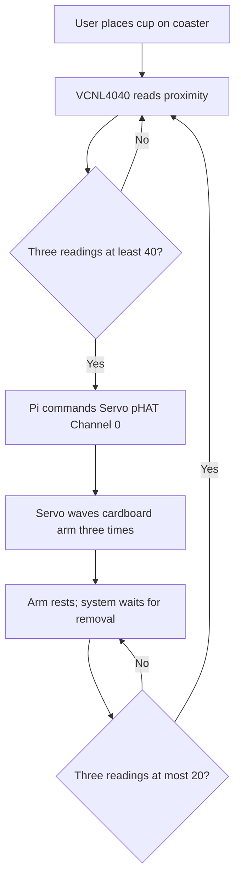

# Ph-UI!!!

<details>
	<summary><strong>Instructions for Students (Click to Expand)</strong></summary>
  
	**Submission Cleanup Reminder:**
	- This README.md contains extra instructional text for guidance.
	- Before submitting, remove all instructional text and example prompts from this file.
	- You may delete these sections or use the toggle/hide feature in VS Code to collapse them for a cleaner look.
	- Your final submission should be neat, focused on your own work, and easy to read for grading.
  
	This helps ensure your README.md is clear, professional, and uniquely yours!
</details>

---

---

## Lab Overview
Team: <canvas group name>  
Members: Shenye Wang（sw2486） & Bowei Huang（bh654）

Project name: Cup Companion


For lab this week, we focus on both sensing and actuation, bringing new modes of input and output into your devices, while also prototyping the physical structure and overall look of the device. You will consider how the physical form supports sensing and actuation, and how these elements come together to shape the interaction and aesthetics of the device.

---

## Lab Structure

A) [Capacitive Sensing](#part-a)

B) [More Sensors](#part-b)

C) [Servo Actuation](#part-c)

D) [Physical Interaction Design: Feast Automata](#part-d)

E) [Build & Integrate](#part-e)

F) [Final Documentation](#part-f)

---

## Part 1 Lab Preparation

---

### Get the latest content:
As always, pull updates from the class Interactive-Lab-Hub to both your Pi and your own GitHub repo. As we discussed in the class, there are 3 ways you can do so:


Option 1: On the Pi, `cd` to your `Interactive-Lab-Hub`, pull the updates from upstream (class lab-hub) and push the updates back to your own GitHub repo. You will need the personal access token for this.
```
pi@ixe00:~$ cd Interactive-Lab-Hub
pi@ixe00:~/Interactive-Lab-Hub $ git pull upstream Fall2026
pi@ixe00:~/Interactive-Lab-Hub $ git add .
pi@ixe00:~/Interactive-Lab-Hub $ git commit -m "get lab4 content"
pi@ixe00:~/Interactive-Lab-Hub $ git push
```

Option 2: On your own GitHub repo, [create pull request](https://github.com/FAR-Lab/Developing-and-Designing-Interactive-Devices/blob/2021Fall/readings/Submitting%20Labs.md) to get updates from the class Interactive-Lab-Hub. After you have latest updates online, go on your Pi, `cd` to your `Interactive-Lab-Hub` and use `git pull` to get updates from your own GitHub repo.

Option 3: (preferred) use the Github.com interface to update the changes.

---

### Quick Start: Python Environment Setup

1. **Create and activate a virtual environment in Lab 4:**
	```bash
	cd ~/Interactive-Lab-Hub/Lab\ 4
	python3 -m venv .venv
	source .venv/bin/activate
	```
2. **Install all Lab 4 requirements:**
	```bash
	pip install -r requirements2025.txt
	```
3. **Check CircuitPython Blinka installation:**
	```bash
	python blinkatest.py
	```
	If you see "Hello blinka!", your setup is correct. If not, follow the troubleshooting steps in the file or ask for help.

---

### Gathering materials for this lab:

* Cardboard (start collecting those shipping boxes!)
* Found objects and materials--like bananas and twigs.
* Cutting board
* Cutting tools
* Markers


(We do offer shared cutting board, cutting tools, and markers on the class cart during the lab, so do not worry if you don't have them!)

---

### Prototyping References 

* [What do prototypes prototype?](https://www.semanticscholar.org/paper/What-do-Prototypes-Prototype-Houde-Hill/30bc6125fab9d9b2d5854223aeea7900a218f149)
* [Paper prototyping](https://www.uxpin.com/studio/blog/paper-prototyping-the-practical-beginners-guide/) is used by UX designers to quickly develop interface ideas and run them by people before any programming occurs. 
* [Cardboard prototypes](https://www.youtube.com/watch?v=k_9Q-KDSb9o) help interactive product designers to work through additional issues, like how big something should be, how it could be carried, where it would sit. 
* [Tips to Cut, Fold, Mold and Papier-Mache Cardboard](https://makezine.com/2016/04/21/working-with-cardboard-tips-cut-fold-mold-papier-mache/) from Make Magazine.
* [Surprisingly complicated forms](https://www.pinterest.com/pin/50032245843343100/) can be built with paper, cardstock or cardboard.  The most advanced and challenging prototypes to prototype with paper are [cardboard mechanisms](https://www.pinterest.com/helgangchin/paper-mechanisms/) which move and change. 
* [Dyson Vacuum Cardboard Prototypes](http://media.dyson.com/downloads/JDF/JDF_Prim_poster05.pdf)
<p align="center"> </p>

### Feast Automata Inspirations

* [Simone Giertz - The Breakfast Machine](https://www.youtube.com/watch?v=E2evC2xTNWg) turns an everyday breakfast routine into a deliberately awkward robotic performance.
* [Pee-wee’s Big Adventure - Breakfast Machine](https://www.classhook.com/resources/1295-pee-wee-s-big-adventure-pee-wee-s-breakfast-machine?utm_source=chatgpt.com) An elaborate Rube Goldberg-style machine turns the ordinary routine of making breakfast into a playful mechanical performance.
* [Wallace & Gromit - The Autochef](https://www.google.com/search?sca_esv=66d2cd5ecf989ed9&sxsrf=APpeQnuwAWHrA3R0b1GeoQ4r-spKos3vUQ:1789367781228&udm=7&fbs=ABfTbFVyMZGZf1hfvX9uKjN_-G8cxpBkeIeqYwoCbfNVc4vKE7plZzta63Pe5DpJ3XFR9XzI_yj6fb6bfPt1x_5u3nRcG7tR9jg4Omd7-UnDuaw5i86wRQqe-045kPXObjb1eDS649ikhB0y_hSFYfNioDnA60A2i_oC1IzIZywb7ERnDQqnSx10JnfJEaAauzJXglx4123_vjf0_54bKrF6QjM9ne5i3g&q=Wallace+%26+Gromit+%E2%80%94+The+Autochef&sa=X&ved=2ahUKEwiI0OO3uu2WAxVHEFkFHQ3iAOEQtKgLegQIFRAB&biw=1197&bih=613&dpr=2.5#fpstate=ive&vld=cid:72c3eb07,vid:2igRcGxlshA,st:0)
* [Nik Ramage - Jelly Wobbler](http://www.youtube.com/watch?v=pj2t71q68sY#t=33) makes the simple act of wobbling jelly into a dedicated machine.
* [Zekun Chang - Blah Blah](https://zekunchang.com/portfolio/blah-blah/) is an alcohol machine that presents a playful commentary on drunken behavior.

### Mechanical Prototyping Resource

* [Gear Template Generator](https://woodgears.ca/gear_cutting/template.html) can help you prototype simple gear mechanisms for translating servo motion into physical movement.


---

### Part A
### Capacitive Sensing, a.k.a. Human-Twizzler Interaction 

We want to introduce you to the [capacitive sensor](https://learn.adafruit.com/adafruit-mpr121-gator) in your kit. It's one of the most flexible input devices we are able to provide. At boot, it measures the capacitance on each of the 12 contacts. Whenever that capacitance changes, it considers it a user touch. You can attach any conductive material. In your kit, you have copper tape that will work well, but don't limit yourself! In the example below, we use Twizzlers--you should pick your own objects.


<p float="left">

 
</p>

Plug in the capacitive sensor board with the QWIIC connector. Connect your Twizzlers with either the copper tape or the alligator clips (the clips work better). Install the latest requirements from your working virtual environment:

These Twizzlers are connected to pads 6 and 10. When you run the code and touch a Twizzler, the terminal will print out the following

```
(circuitpython) pi@ixe00:~/Interactive-Lab-Hub/Lab 4 $ python cap_test.py 
Twizzler 10 touched!
Twizzler 6 touched!
```

---

### Part B
### More sensors

#### Light/Proximity/Gesture sensor (APDS-9960)

We here want you to get to know this awesome sensor [Adafruit APDS-9960](https://www.adafruit.com/product/3595). It is capable of sensing proximity, light (also RGB), and gesture! 
 

 

Connect it to your pi with Qwiic connector and try running the three example scripts individually to see what the sensor is capable of doing!

```
(circuitpython) pi@ixe00:~/Interactive-Lab-Hub/Lab 4 $ python proximity_test.py
...
(circuitpython) pi@ixe00:~/Interactive-Lab-Hub/Lab 4 $ python gesture_test.py
...
(circuitpython) pi@ixe00:~/Interactive-Lab-Hub/Lab 4 $ python color_test.py
...
```

You can go the the [Adafruit GitHub Page](https://github.com/adafruit/Adafruit_CircuitPython_APDS9960) to see more examples for this sensor!

#### Rotary Encoder 

A rotary encoder is an electro-mechanical device that converts the angular position to analog or digital output signals. The [Adafruit rotary encoder](https://www.adafruit.com/product/4991#technical-details) we ordered for you came pre-soldered, so you do NOT need to solder anything.
<p float="left">

   


</p>

Connect it to your pi with Qwiic connector and try running the example script, it comes with an additional button which might be useful for your design!

```
(circuitpython) pi@ixe00:~/Interactive-Lab-Hub/Lab 4 $ python encoder_test.py
```

You can go to the [Adafruit Learn Page](https://learn.adafruit.com/adafruit-i2c-qt-rotary-encoder/python-circuitpython) to learn more about the sensor! The sensor actually comes with an LED (neo pixel): Can you try lighting it up? 

#### Joystick 


A [joystick](https://www.sparkfun.com/products/15168) can be used to sense and report the input of the stick for it pivoting angle or direction. It also comes with a button input!

<p float="left">

</p>

Connect it to your pi with Qwiic connector and try running the example script to see what it can do!

```
(circuitpython) pi@ixe00:~/Interactive-Lab-Hub/Lab 4 $ python joystick_test.py
```

You can go to the [SparkFun GitHub Page](https://github.com/sparkfun/Qwiic_Joystick_Py) to learn more about the sensor!

#### Distance Sensor


Earlier we have asked you to play with the proximity sensor, which is able to sense objects within a short distance. Here, we offer [Sparkfun Proximity Sensor Breakout](https://www.sparkfun.com/products/15177), With the ability to detect objects up to 20cm away.

<p float="left">


</p>

Connect it to your pi with Qwiic connector and try running the example script to see how it works!

```
(circuitpython) pi@ixe00:~/Interactive-Lab-Hub/Lab 4 $ python qwiic_distance.py
```

You can go to the [SparkFun GitHub Page](https://github.com/sparkfun/Qwiic_Proximity_Py) to learn more about the sensor and see other examples

---

### Part C
### Servo Actuation

Now that you have explored several forms of sensing, add physical output by learning to control a servo motor. Complete the Servo pHAT setup and basic servo test before beginning your interaction design.

### Servo Control with SparkFun Servo pHAT
For this lab, you will use the **SparkFun Servo pHAT** to control a micro servo (such as the Miuzei MS18 or similar 9g servo). The Servo pHAT stacks directly on top of the Adafruit Mini PiTFT (135×240) display without pin conflicts:
- The Mini PiTFT uses SPI (GPIO22, 23, 24, 25) for display and buttons ([SPI pinout](https://pinout.xyz/pinout/spi)).
- The Servo pHAT uses I²C (GPIO2 & 3) for the PCA9685 servo driver ([I2C pinout](https://pinout.xyz/pinout/i2c)).
- Since SPI and I²C are separate buses, you can use both boards together.
**⚡ Power:**
- Plug a USB-C cable into the Servo pHAT to provide enough current for the servos. The Pi itself should still be powered by its own USB-C supply. Do NOT power servos from the Pi’s 5V rail.

<p align="center">
    
</p>

**Basic Python Example:**
We provide a simple example script: `Lab 4/pi_servo_hat_test.py` (requires the `pi_servo_hat` Python package).
Run the example:
```
python pi_servo_hat_test.py
```
For more details and advanced usage, see the [official SparkFun Servo pHAT documentation](https://learn.sparkfun.com/tutorials/pi-servo-phat-v2-hookup-guide/all#resources-and-going-further).
A servo motor is a rotary actuator that allows for precise control of angular position. The position is set by the width of an electrical pulse (PWM). You can read [this Adafruit guide](https://learn.adafruit.com/adafruit-arduino-lesson-14-servo-motors/servo-motors) to learn more about how servos work.

---

### Part D -- Physical Interaction Design: Cup Companion
Project Concept
Cup Companion turns placing a cup on a coaster into a playful interaction. A proximity sensor detects the cup, and a servo makes a cardboard character wave. When the cup is removed, the arm returns to its resting position.

**\*\*\*Draw 5 sketches that explore different physical arrangements for your sensing and actuation.\*\*\***

Five Design Sketches
We explored five physical arrangements for the same interaction:
1. Side Buddy: The character stands beside the cup on a shared base.
2. Backboard Buddy: The character is attached to a vertical backboard behind the cup.
3. Raised Platform: A raised base provides space to house the electronics.
4. Separate Modules: The character and coaster are separate, allowing their positions to be adjusted independently.
5. Arch Buddy: An arch supports the character and positions the sensor above the cup.


**\*\*\*What questions do these sketches raise? What do you need to physically prototype to answer them?\*\*\***

The sketches raised questions about sensor placement, arm clearance, and structural stability. Where should the sensor sit to reliably detect the cup? Could a hand placing the cup accidentally trigger the interaction? Would the waving arm hit the cup or backboard? Could the cardboard support the servo without bending or tipping?
To answer these questions, we need to test sensor readings with and without a cup, try different cup positions, and prototype the arm’s movement and servo mounting.

**\*\*\*Pick one design to prototype and explain why.\*\*\***

We selected Design 2: Backboard Buddy because the vertical backboard provides a simple surface for mounting the character, sensor, and servo. The coaster gives users a clear place to put their cup, while the character remains visible above it. This arrangement also allows us to adjust component positions easily during testing.
We plan to use a SparkFun VCNL4040 proximity sensor near the bottom of the backboard, facing the cup. The servo will be mounted behind the character’s shoulder and connected to a separate cardboard arm. The body will remain stationary while the arm waves.

Build a cardboard or other low-fidelity physical prototype of your design.

We built a rough prototype using cardboard for the base, vertical backboard, circular coaster, character, and separate arm. We positioned the sensor near the bottom of the backboard and used a cup to explore the overall layout.
The video documents the intended interaction through manual simulation. The character is temporarily held in place during the demonstration; automatic sensing and servo movement have not yet been integrated into this prototype.
For the next iteration, we will secure the character’s body, mount the servo, and test the arm’s range of movement. We will also adjust the sensor position and detection threshold using readings with and without the cup.

**\*\*\*Document your rough prototype with photos and/or video.\*\*\***

https://github.com/user-attachments/assets/61a3d197-d91c-48a4-9360-3b7e3afbb6f0


---

## Part 2

Following exploration and reflection from Part 1, complete the "looks like," "works like" and "acts like" prototypes for your design, reiterated below.

---

## Part E — Build & Integrate: Sensing + Actuation

### System Overview

Cup Companion turns placing a cup on a coaster into a playful physical interaction. A SparkFun VCNL4040 proximity sensor detects the cup, and the Raspberry Pi controls a servo through the SparkFun Servo pHAT to wave a cardboard character’s arm.

When the cup is detected, the arm waves three times and returns to rest. The system waits for the cup to be removed before allowing another wave.

### Hardware and Physical Integration

The Servo pHAT connects to the Pi’s GPIO header. The servo connects to Channel 0, and the VCNL4040 connects through the pHAT’s Qwiic interface. The Pi and Servo pHAT use separate USB-C power connections.

We mounted the servo at the character’s shoulder and attached the separate cardboard arm to its horn. The character’s body stays fixed to the vertical backboard. The Pi and control board remain beside the model for access during testing.


*Assembly process: connecting the servo to the control board and attaching the cardboard arm to the servo mechanism.*

The distance sensor is secured to the front of the backboard, facing the cup placement area. Its sensing surface remains exposed. The circular cardboard coaster gives the user a clear target for placing the cup.


*The VCNL4040 is mounted on the backboard with its sensing surface facing the cup.*

### Interaction Diagram



### Code

[View cup_companion.py](cup_companion.py)

The program checks proximity approximately every 0.1 seconds while waiting. Three consecutive readings of at least 40 trigger the waving sequence. Three consecutive readings of 20 or below indicate removal and reset the system.

The two thresholds provide a buffer against fluctuating readings. A cup-presence state prevents repeated waving while the cup stays on the coaster. Each wave alternates between two servo positions, with a 0.3-second pause at each position.

### Testing and Iteration

We first tested the servo independently and then measured proximity values using our cup:

- **Cup present:** approximately 73–91.
- **Cup absent:** approximately 5–8.

Based on these measurements, we selected 40 for detection and 20 for removal. These values were chosen for our tested cup and sensor arrangement, rather than as universal distance measurements.

We then tested the combined sensing and servo program before installing the mechanism in the cardboard model.

During assembly, we explored a smaller waving range by reducing the difference between the resting and raised positions. This made the movement visibly smaller, showing that the servo angle needs to be judged with the actual cardboard arm attached. We used the movement tests to guide the physical assembly and arm clearance.

The attached video shows the assembled prototype responding to cup placement with physical arm movement.

### Working Prototype Video


https://github.com/user-attachments/assets/c81212f8-8f0a-43e9-9d39-bd29ef3e89c3


*The demonstration shows the assembled device, cup placement and removal, and the servo-driven cardboard arm.*

### Reflection

We learned that sensing, movement, and physical form must be developed together. The sensor needs a clear view of the cup, while the coaster helps position the cup within the intended sensing area. Changing the sensor’s position or cup placement can change the readings and may require new thresholds.

The servo also needs a firm mount so its motion moves the arm rather than the motor body. Testing the cardboard arm showed why movement settings cannot be judged only from an unloaded servo: a smaller angular range produced a noticeably smaller gesture.

The most enjoyable part was seeing an ordinary cup placement make the cardboard character respond. The main challenge was translating working electronics into a physical structure with a fixed body, moving arm, and accessible wiring.

One limitation is that the sensor detects nearby objects, not cup identity. A hand passing close to it may also trigger the interaction. Further testing with different cups and hand movements would help refine sensor placement and detection timing.

### Contributions and AI Assistance

We built and assembled the cardboard prototype, connected the hardware, and tested the interaction. ChatGPT helped develop the Python program, explain setup steps, and organize the documentation. The implementation uses the course examples for proximity sensing and Servo pHAT control.


---

## Part F — Final Documentation

### Looks Like

Cup Companion has a cardboard base, a circular coaster, and a vertical backboard featuring a smiling character. A separate cardboard arm provides the moving element. The proximity sensor is mounted on the front of the backboard, while the Pi and Servo pHAT remain beside the model.

The assembly photos in Part E document the arm mechanism and sensor mounting. The demonstration video shows the overall appearance of the assembled prototype.

### Works Like

The VCNL4040 reads proximity values from the cup placement area. The Raspberry Pi uses these readings to trigger a servo-driven wave through the Servo pHAT.

The arm waves three times and returns to rest. The program waits for the cup to be removed before resetting for another interaction.

[View the sensing and actuation code](cup_companion.py)

### Acts Like

The user places a cup on the circular coaster, and the cardboard character responds by waving. The user can lift the cup and place it back to trigger another response. No separate button or screen interaction is required.

For the Video please see part E -- Working Prototype Video

### Prototype Development

Our design developed through three stages:

1. **Concept sketches:** We explored five arrangements of the character, sensor, actuator, and coaster. We selected the backboard design because it provided a simple mounting surface and kept the character visible.
2. **Rough physical prototype:** We built the cardboard structure and manually simulated the intended interaction to explore the layout.
3. **Integrated prototype:** We tested the sensor and servo, selected detection thresholds from measured readings, and attached the moving arm to the servo. We also explored a smaller movement range during assembly.

The final prototype connects sensing, programmed movement, and a physical character to make an everyday drinking-related action playful. The development process showed that working code and electronics must be tested again within the physical structure.

Process photos, the interaction diagram, testing details, and reflection are documented in Part E. The five design sketches and rough prototype are documented in Part D.
